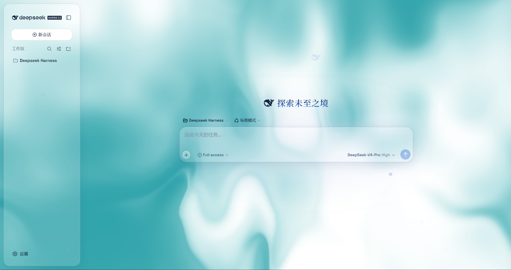
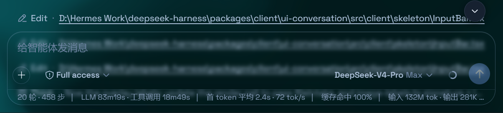

># @deepseek-ai/dsh-client-ui-aqua

**Aqua** 是一层高自由度的玻璃质感主题（glassmorphism），套在 DeepSeek Harness 网页端：顶栏、侧边栏、输入框、统计行、轨迹视图全部变成磨砂玻璃片，支持流体背景或图片/视频壁纸。关掉总开关即完全还原原生界面，不改 DSH 任何一行源码。

> **署名 / Credits**
> - 原作者：**WYH66666666** — https://github.com/WYH66666666/DSH-Transparent-UI-Plugin
> - 0.1.1-rc.2 适配：**du-u-uck** — https://github.com/du-u-uck/DSH-Transparent-UI-Plugin
> - v0.2.x 适配（本仓库）：**acdsh4869**







## 特性

- **双模式**：**云母效果**把布局改成悬浮玻璃卡片（模糊度、磨砂度可调）；**兼容模式**保持原版排版不变，只把材质换成通用玻璃，其他插件的界面也会自动玻璃化
- **背景自由**：流体板（色调/深浅可调）或自定义图片/视频壁纸（铺满页面、比例不变，可单独调模糊度/磨砂度）；浅色壁纸配浅色模式、深色壁纸配深色模式观感更佳
- **背景亮度**：自动跟随深浅模式——深色模式 0–50 压暗、浅色模式 50–100 提亮，50 原样
- **粒子鲸鱼 / 小鱼 / 网状交互 / 鼠标辉光 / 悬停下压**等环境与悬停装饰，均可单独开关
- **一键恢复默认**：设置里的「恢复默认效果」按钮可把全部调节项恢复出厂默认
- 一键开关：关闭即完全还原原生界面，无残留

## 安装（v0.2.x 适配版）

> ⚠️ **npm 一键安装（`dsh plugin --profile web add dsh-client-ui-aqua`）拉到的是未适配 v0.2.x 的旧版**，请勿使用，直到本适配版发布到 npm。

### 方式一：PowerShell 一键安装（推荐）

```powershell
irm https://raw.githubusercontent.com/acdsh4869/DSH-Transparent-UI-Plugin/main/install.ps1 | iex
```

脚本会：① 从本仓库下载最新 Release；② 把插件链接进 `%USERPROFILE%\.dsh\profiles\node_modules\@deepseek-ai\dsh-client-ui-aqua`；③ 在 `profiles\web\cordis.patch.yml` 登记 `ui-aqua`（幂等，重复运行安全）。完成后**刷新 Web 界面**即可。

指定版本或分支：`-Version 'v2.0.0-rc.1'` / `-Version 'main'`；DSH 不在默认位置时加 `-DshHome`。

### 方式二：本地文件夹安装

下载或 clone 本仓库到本地，然后：

```powershell
powershell -ExecutionPolicy Bypass -Command ".\install.ps1 -Source '绝对路径\DSH-Transparent-UI-Plugin' -Profile web"
```

本地路径会建立 **junction 软链**（实时生效，之后在本文件夹里改代码/重建会直接反映到 DSH，无需重装）。

**macOS / Linux（手动三步）：**

```sh
git clone https://github.com/acdsh4869/DSH-Transparent-UI-Plugin.git
ln -s "$PWD/DSH-Transparent-UI-Plugin" "$DSH_HOME/profiles/node_modules/@deepseek-ai/dsh-client-ui-aqua"
```

再往 `$DSH_HOME/profiles/web/cordis.patch.yml` 追加：

```yaml
- insert:
    - id: ui-aqua
      name: '@deepseek-ai/dsh-client-ui-aqua'
```

> 💡 也可以把整个仓库文件夹丢给其他 Agent 帮忙安装，有问题让它自己修复。

## 使用

刷新 Web 界面，Aqua **默认开启**：

- **总开关**：设置 → 插件 → 点击 **Aqua / dsh-client-ui-aqua** bundle 卡片进入详情页 → 玻璃主题开关卡片。
- **全部调节**：设置 → 通用设置 → 外观 正下方（无独立标题）—— 模式（云母/兼容）、模糊度/磨砂度、流体颜色、背景亮度、背景（流体/壁纸）、壁纸设置、环境装饰（鲸鱼/小鱼/网状交互）与悬停效果开关，以及「恢复默认效果」一键按钮。总开关关闭时整块调节自动隐藏，界面完全恢复原生样式。

> 若刷新后未出现 Aqua 卡片，重启 dsh web 进程后再试。

## 适配 v0.2.x 说明（当前版本）

本分发版针对 **DeepSeek Harness `0.2.0-rc.2`（含桌面端 v0.22.3 及以上）** 完成适配，版本号 `2.0.0-rc.1`。主要变更：

1. **`ctx.settingsScope` 服务被移除**：插件主卡片迁移到 **`plugins.bundle.config`**（keyed，key = npm 包名）。
2. **`ctx.slots.inject(name, factory)` 回归**：注册恢复为 `ctx.effect(() => ctx.slots.inject(...))`。
3. **`@deepseek-ai/dsh-client-runtime` 消失**：`defineStore` 改用 `@deepseek-ai/dsh-client-store`；`ctx.slots` 类型合并来自 `@deepseek-ai/dsh-client-ui-renderer/client`。
4. **图标改名**：`IconCheckOutline16` → `IconCheckOutlineRegular`。
5. **依赖声明**：`dsh.client.inject` = locale / ui-theme / ui-slots；peerDependencies 只留 `@deepseek-ai/cordis ~4.0.4` + `react ^18.2.0`（不声明 `@deepseek-ai/dsh*` peer，宿主版本检查即通过）。
6. **构建管线**：新增 `scripts/wrap-client.mjs`——把 tsdown ESM 产物后处理为 DSH 要求的 `window.__ModuleLoader__.load(...)` 包裹格式，并直接从 `src/client/` 内联全局主题 CSS（rolldown 会摇掉纯副作用的 CSS 导入，导致早期构建主题整体缺失）。
7. **0.2.x 新布局容器透明化**：`centerCol`/`rightbarCol` 布局列与侧栏面板 frame 根节点的自绘不透明底色置为透明，流体背景可透至主区域。
8. **兼容模式修复**：0.2.x 里 `panel` 类片段命名整栏大容器，已从磨砂选择器中移除（避免半屏模糊）。
9. **新增「恢复默认效果」按钮**：一键恢复出厂默认（保留开关状态）。

细节与历史（含 0.1.1-rc.2 适配记录）见 [CHANGELOG.md](CHANGELOG.md)。

## 开发

```sh
pnpm install
pnpm run bundle   # tsdown + tsc + wrap-client.mjs → 完整 lib/
```

AGPL-3.0 © 原作者 WYH66666666 及各适配者
